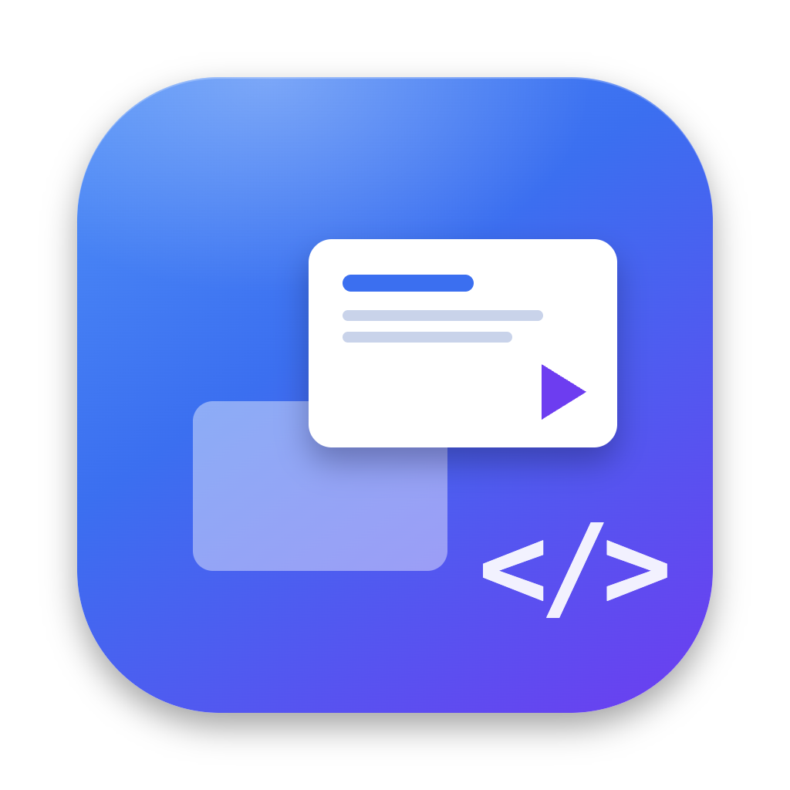
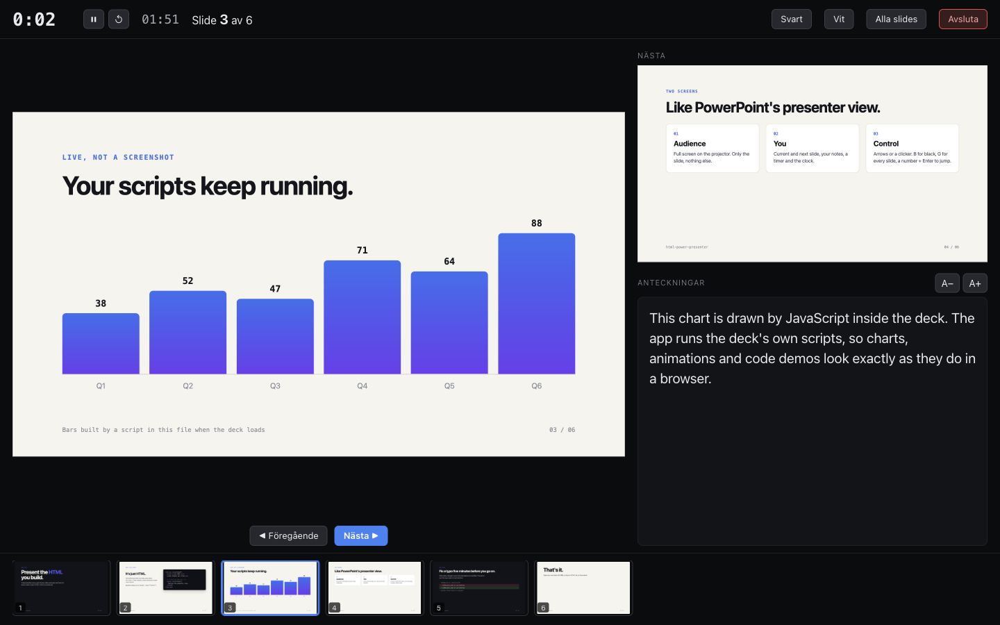
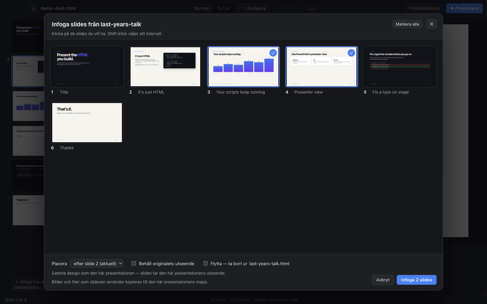

<p align="center"></p>

<h1 align="center">HTML Power Presenter</h1>

<p align="center">Like PowerPoint's presenter view, but for presentations made of HTML, CSS and JavaScript.<br>A macOS desktop app built with Electron.</p>



If you build slide decks as single HTML files (by hand, with reveal.js, or generated by an AI), a browser tab is a poor stage. HTML Power Presenter opens the file and gives you what slide software has:

- **Presenter view on two screens.** The audience sees only the slide, full screen on the projector. You see the current and next slide, your notes, a timer and the clock.
- **Or on one screen, in windows.** Window mode puts the presenter view and the audience side by side, so in Teams or Zoom you can share just the audience window and keep your notes to yourself.
- **A timer that knows the plan.** Give the talk a length and the timer counts down. Time budgets at the start of your notes (`~1.5 min · …`) show whether you are ahead of or behind the plan.
- **Grid of every slide**, with real thumbnails.
- **Reorder, duplicate and delete slides** by dragging thumbnails or from the Slides menu.
- **Bring slides over from another deck**, as a copy or a move, keeping their original look if the two decks are designed differently.
- **Edit mode** for last-minute fixes. Click a text, change it, save. Only the element you edited is rewritten; the rest of the file stays byte for byte identical.
- **Your deck keeps running.** The deck's own scripts, animations, charts and code demos work as in a browser. The app only decides which slide is shown.
- **Made for decks an AI writes.** When the file is regenerated the app reloads it, but never in the middle of a talk. Every version it sees is kept and can be restored. Copy a slide (with its source) or the whole deck as text to paste into Claude. Google Fonts are saved so the slides look the same without a network.

> The app's interface is in Swedish for now (*Redigera* = Edit, *Rutnät* = Grid, *Presentera* = Present, *Infoga* = Insert).

| Normal view | Grid |
|---|---|
|  |  |
| **Edit mode** | **Insert slides from another deck** |
|  |  |

## Install

You need macOS and [Node.js](https://nodejs.org) 22.12 or newer.

```bash
git clone https://github.com/peterkurzwelly/html-power-presenter.git
cd html-power-presenter
npm install
npm start                # run from source
```

To build the app and put it in `~/Applications`:

```bash
npm run install-app
```

This builds `HTML Presenter.app` for your Mac's processor, signs it ad hoc so macOS will run it, and registers it for `.html` files. After that you can right-click any `.html` file in Finder and choose **Open With → HTML Presenter**.

If `npm start` says Electron failed to install, download its binary again with `node node_modules/electron/install.js`.

## Try it

Open [`examples/demo-deck.html`](examples/demo-deck.html): ⌘O, drag the file onto the window, or `npm start -- examples/demo-deck.html`.

## Using it

| | Shortcut |
|---|---|
| Open a deck | ⌘O, or drag an `.html` file onto the window |
| Normal view / Grid | ⌘1 / ⌘2 |
| Edit mode | ⌘E |
| Save / Save as | ⌘S / ⇧⌘S |
| Undo / Redo | ⌘Z / ⇧⌘Z |
| Reload the file from disk | ⌘R |
| Present from the current slide | ⌘↩ |
| Present from the start | ⇧⌘↩ |
| Rehearse (presenter view, no audience window) | ⌥⌘↩ |
| Window mode on or off | **⧉ Fönsterläge** in the toolbar, or the Bildspel menu |
| Show or hide notes | ⌥⌘N |
| Earlier versions of the file | Arkiv → Tidigare versioner… |
| Copy the slide for Claude | ⌥⌘C |
| Copy the whole deck for Claude | ⇧⌥⌘C |
| Open the slide in your code editor | ⌥⌘O |

### While presenting

| Key | Does |
|---|---|
| → ↓ Space PageDown N Enter | next slide |
| ← ↑ PageUp Backspace P | previous slide |
| a number, then Enter | jump to that slide |
| B or . | black screen |
| W or , | white screen |
| G | show every slide |
| T | restart the timer |
| S | pause or resume the timer |
| F | window mode on or off |
| Esc | stop presenting |

Presentation clickers send these keys, so they work too. G, T, S and F only work from the presenter view, so a script in the deck can't change them. With two screens, the audience window goes full screen on the screen the app window is *not* on. **Byt skärmar** (Swap screens, in the Bildspel menu) swaps them. With one screen, the audience window covers it, unless window mode is on. Plug in a projector mid-talk and the audience window moves there.

### Presenting on one screen, or in Teams

Turn on **window mode** (**⧉ Fönsterläge** in the toolbar, the Bildspel menu, or F during the show). The presenter view and the audience then open as ordinary windows:

- **On one screen** they sit side by side: the presenter view on the left, the audience window on the right, at the slide's proportions.
- **On two screens** the audience window opens on the other screen, and the presenter view fills its own.

The audience window is called *Publik – your-deck.html*, so it's easy to pick when you share a window in Teams or Zoom. Your notes stay in the other window. Move and resize both however you like; the app leaves them where you put them, even if you plug in a screen. Closing the audience window asks before it ends the show. The choice is remembered.

### Timing your talk

Click **Mål** next to the timer and give the talk's length. The timer then counts down, shows when you will finish, turns amber near the end and red with a +m:ss count when you run over. Click the time to switch between time left and time spent. **S** pauses it. The length is saved for each file.

If a note starts with a time budget, like `~1.5 min · Say that…`, the presenter view shows the time on the slide against its budget, and whether you are ahead of the plan, on it, or behind. Slides without a budget share what is left of the talk length. The status bar shows how much time the notes add up to. See the [deck contract](docs/DECK-CONTRACT.md#time-budgets) for the format.

If you end the show by mistake and start it again within 15 minutes, the timer carries on. T starts it from zero.

### Rearranging slides

Drag a thumbnail in the sidebar or the grid to move the slide. Or use the **Slides** menu:

| | Shortcut |
|---|---|
| Move slide up / down | ⌥⌘↑ / ⌥⌘↓ |
| Move slide to the start / end | ⇧⌥⌘↑ / ⇧⌥⌘↓ |
| Duplicate slide | ⌘D |
| Delete slide | ⌫ in the grid or sidebar, or **Ta bort slide** in the menu |

A slide moves together with the HTML comment just above it (often its title, like `<!-- 3 Pricing -->`). Anything else between slides, such as a `<script>` that draws a chart, stays where it is and is never deleted or copied. Notes kept in a `<script id="speaker-notes">` list are reordered to match. Every change can be undone with ⌘Z and nothing is written to disk until you save.

This works when all slides sit side by side in the same parent element, which is how nearly every deck is built.

### Inserting slides from another deck

Choose **Slides → Infoga slides från annan presentation…** (⇧⌘I) or the button under the thumbnails, and pick another `.html` file. You get a grid of its slides:

- **Click** the slides you want. Shift-click selects a range.
- **Placera** (Place): after the current slide, first, or last.
- **Behåll originalets utseende** (Keep the original look): the slide is wrapped with the CSS rules it needs from the other deck, scoped with `@scope` so they can't leak into the rest of your deck. Fonts and animations it uses come along (renamed if your deck already uses the same names), and it's scaled to fit if the slide sizes differ. A `<style>` inside an inserted slide is limited to that slide either way. The app ticks this for you when the two decks look differently designed. Leave it off when both decks share a design; the slide then takes on this deck's look.
- **Flytta** (Move): also removes the slides from the other file. This saves both files, and it can't be undone with ⌘Z. The backup folder keeps a copy of the other file as it was, and of this one as it was when you opened it. If the move can't be completed (say it would leave the other deck empty), nothing is changed.

Images, videos, fonts and stylesheets the slides refer to with relative paths are copied into this deck's folder: to the same relative path if that's free, otherwise into `assets-from-<other deck>/`. Only files inside the other deck's own folder are copied, the same rule the app uses when it shows a deck. Speaker notes come along.

### Versions

Every version of the file that the app sees is kept: when you open it, when you save, and when another tool rewrites it. **Arkiv → Tidigare versioner…** lists them. **Återställ** puts that version back in the file (the version you had stays in the list); **Spara kopia…** saves it next to the deck under another name. Versions with the same content are kept once, at most 40 per deck, in `~/Library/Application Support/HTML Presenter/Versioner/`.

### Working with Claude

- **Slides → Kopiera slide för Claude** (⌥⌘C) copies the current slide's HTML, its notes and title, the file's path and the line where the slide starts. Embedded images are left out, so a 10 MB deck doesn't flood the conversation. Paste it into Claude with what you want changed.
- **Slides → Kopiera decket för Claude** (⇧⌥⌘C) copies every slide's title, visible text, notes and time budget as short Markdown. The submenu can put a request first: prepare questions and answers, cut the talk to its length, or review the storyline.
- **Slides → Visa i kodeditor** (⌥⌘O) opens the file in VS Code, Cursor or Windsurf at the line of the current slide, or of the element you ⌥-clicked in edit mode.
- **Slides → Ge slides fasta id** gives each slide a `data-slide-id` made from its title, so it can be recognised after Claude rewrites the file.

When Claude rewrites the file while you are presenting, the new version waits: a note in the presenter view says it's there, and it loads when the show ends (or when you click **Läs in nu**).

The [deck contract](docs/DECK-CONTRACT.md) lists what the app reads from a deck, as a checklist for whatever generates your decks.

### Fonts without a network

Most generated decks load their fonts from Google Fonts. The app saves them the first time a deck is shown with a network and uses the saved copies after that, so text wraps the same on a venue's Wi-Fi or with none. Your file is not changed; the status bar says when a deck's fonts are saved. **Bildspel → Testa utan nät** shows the deck as it would look with no network at all, to check before you go.

### Editing

Press ⌘E. Then:

- **Click a text** to edit it in place. Esc or a click elsewhere finishes.
- **⌥-click** selects a whole element (an image, a card, a row). **↑ Yttre element** selects the element around it.
- **⌫** deletes the selected element.
- **⌘Z** undoes, **⌘S** saves.

Some texts can't be edited, and the app says so instead of guessing:

- Text that the deck's own scripts change after loading, such as formulas rendered by KaTeX, highlighted code or animated counters. Saving it would write the script's output into your file.
- Elements the browser had to repair because tags in the source cross each other (like `<b>` spanning two paragraphs).
- Files that aren't saved as UTF-8. These open read-only, marked **Skrivskyddad**. Save the file as UTF-8 in your editor to edit it here.

The first save after opening a file puts a copy of the original in `~/Library/Application Support/HTML Presenter/Säkerhetskopior/`.

If the file changes on disk while it's open (say you regenerate it with an AI tool), the app reloads it. If you have unsaved edits, it asks first. Closing the window, quitting or opening another file also asks, and counts a text you're in the middle of typing as an unsaved edit.

## What decks work

Any HTML file where each slide is its own element. The [deck contract](docs/DECK-CONTRACT.md) has the details, and a checklist for decks made by an AI. The app looks for slides in this order and uses the first rule that finds two or more:

`deck-stage > section` · `.reveal .slides > section` · `.slides > section` · `section.slide` · `div.slide` · `.slide` · `[data-slide]` · `body > section` · `main > section` · `.step` · `body > article` · the element with the most `<section>` children · finally a group of sibling elements with the same tag and class that are each about the size of the page, or shown one at a time.

If the deck hides inactive slides until they get a class such as `active`, `on` or `current`, the app works out which class it is and uses it.

**Slide size** comes from `<deck-stage width height>`, from `<meta name="slide-size" content="1600x900">`, or is measured from the first slide. If none of those work, it's 1920×1080.

**Speaker notes** can be any of:

```html
<section class="slide">
  …
  <aside class="notes">Shown only in the presenter view.</aside>
</section>

<section class="slide" data-notes="Also works as an attribute.">…</section>

<script type="application/json" id="speaker-notes">["Notes for slide 1", "Notes for slide 2"]</script>
```

## Security

A deck runs its own JavaScript inside the app, just as it would in a browser. What it can't do:

- **Reach the app.** The deck is served from its own origin (`hpres://deck`), separate from the app's interface (`hpres://app`). It can't call the app's API, open other files, or save. The app and the deck talk only through `postMessage`, and both sides check where each message comes from. What the deck reports about itself (slide count, titles, notes) is type-checked and only ever shown as text.
- **Write to your file.** A deck's scripts can post the same messages as the app's own editing code. The app accepts a text edit only in edit mode, for a text you started editing, and only if the change is plain text (it may remove elements or add line breaks, never add markup).
- **Read files outside its folder.** It can read files in its own folder and subfolders, so `assets/` work. Paths are resolved through symlinks before the check, so a link in the folder can't point it elsewhere.
- **Navigate the app away.** Links to websites open in your default browser. A deck can't open new app windows. Its own iframes (a YouTube embed, a local demo) load inside it as they would in a browser.
- **Use the camera, microphone, location or notifications.** Every such request is denied, for the deck and everything inside it.

It can reach the network, for web fonts and the like. Open decks you would also open in a browser. Google Fonts go through the app (only the ones the deck links to), so they can be saved for use without a network.

## How it works

- The deck is loaded once per view (main view, presenter's current and next slide, audience window). [`controller.js`](src/renderer/controller.js) is injected first in `<head>`. It finds the slides and catches the keyboard so the deck's own navigation never fires. It then shows one slide at a time, pinned to a box the size of the slide. The app scales that box to fit.
- Thumbnails are rendered in a hidden window that steps through the slides and captures each one.
- **Edits are surgical.** On open, every element in `<body>` gets a `data-hp-id` attribute in an in-memory copy of the source ([`deckstore.mjs`](src/main/deckstore.mjs)). An edit replaces only the inside of that one element in the copy, and only if the source still matches what the browser shows. Moving or deleting a slide cuts and pastes the slide's exact source text. Saving removes exactly the attributes that were added, so everything you didn't touch is written back unchanged.
- **Inserted slides** are read straight from the other file's source. For *keep the original look*, the other deck is loaded in a hidden window and the browser itself reports which CSS rules apply to the chosen slides ([`importer.mjs`](src/main/importer.mjs)).

| File | Role |
|---|---|
| `src/main/main.mjs` | Windows, displays, menus, the `hpres://` file server, file watching, IPC |
| `src/main/deckstore.mjs` | Source text, element markers, edits, slide moves, undo, save |
| `src/main/importer.mjs` | Inserting slides from another deck: styles, assets, adapting to this deck |
| `src/main/thumbs.mjs` | Thumbnails in a hidden window |
| `src/main/versions.mjs` | A compressed copy of each version of the file |
| `src/main/fontcache.mjs` | Google Fonts through the app, saved for use without a network |
| `src/main/forclaude.mjs` | The text copied for Claude |
| `src/main/policy.mjs` | Permission requests (all denied) and Testa utan nät |
| `src/renderer/timing.mjs` | Time budgets in notes, the plan and the pace |
| `src/main/preload.cjs` | The API the app's UI uses to talk to the main process |
| `src/renderer/controller.js` | Runs inside the deck: slides, navigation, media, editing, style collection |
| `src/renderer/slideview.js` | One scaled view of a live deck |
| `src/renderer/app.js` | Main window: start screen, normal view, grid, editing, rearranging, presenter view |
| `src/renderer/audience.*` | The audience window |

## Development

```bash
npm start                               # run from source
npm run dual                            # start with window mode on
npm test                                # unit tests, then the end-to-end test on the demo deck
npm run test:unit                       # unit tests only
node scripts/smoke-test.mjs <deck.html> # end-to-end test on a copy of any deck
node scripts/screenshots.mjs            # regenerate the screenshots in docs/
npx electron scripts/make-icon.cjs      # redraw the app icon
npm run package                         # build into dist/ without installing
```

The end-to-end test drives the real app with Playwright on a copy of the deck; it never touches the original. It checks that:

- the views, thumbnails and arrow keys work;
- the deck can read files in its own folder, but not outside it, not through a symlink, and can't reach the app;
- messages forged by the deck's own script change nothing, and iframes inside the deck still load;
- editing a text and saving changes only that text in the file, and deleting an element can be undone;
- dragging thumbnails and the Slides menu reorder, duplicate and delete slides, and undo walks all of it back;
- inserting a slide from a differently designed deck keeps its look, copies its image and brings its note, and moving one removes it from the other file with a backup; moving every slide out of a deck is refused without changing anything;
- a second ⌘D pressed before the views reload can't corrupt the deck;
- presenting opens an audience window that follows the presenter;
- in window mode the audience window sits beside the presenter view at the slide's proportions, F switches to full screen and back mid-show, and only the current slide runs live in the presenter view;
- a talk length makes the timer count down, the notes' time budgets show the pace, and S pauses;
- a file rewritten during the show waits, and loads when the show ends;
- slide ids are added without changing anything else, and the slide and deck are copied for Claude without internal markers or embedded images;
- every version is kept and the oldest one restores the file exactly;
- Google Fonts load through the app, and with Testa utan nät on other requests fail while the saved fonts still load.

The unit tests (`scripts/unit-deckstore.mjs` and `scripts/unit-studio.mjs`) cover the source-editing rules, time budgets, versions, the font cache and the text for Claude. GitHub Actions runs both on macOS for every push.

Set `HP_EXEC` to the path of a built app's binary to test the packaged app instead of the source. The deck-store unit tests cover the source-editing rules: byte-identical round trips, slide moves with comments and notes, text between slides surviving deletes and copies, notes in every supported form (including ones containing `</script>`), refusing edits that would save script output or add markup, UTF-8 BOMs, read-only non-UTF-8 files, unique backups, and what an imported slide may copy and how its styles are scoped.

## Status

Early version, built for my own talks and tested on macOS (Apple Silicon) with about a dozen real decks. The two-screen presenter view and window mode have mostly been tested on one screen; sharing the audience window has not yet been tried in a real Teams or Zoom call. Developer tools are only in the menu when the app runs from source (or with `HP_DEVTOOLS=1`).

## License

[MIT](LICENSE) © 2026 Peter Kurzwelly
