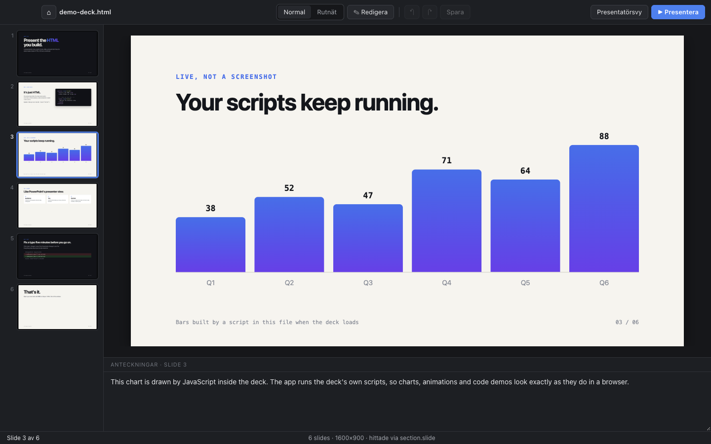
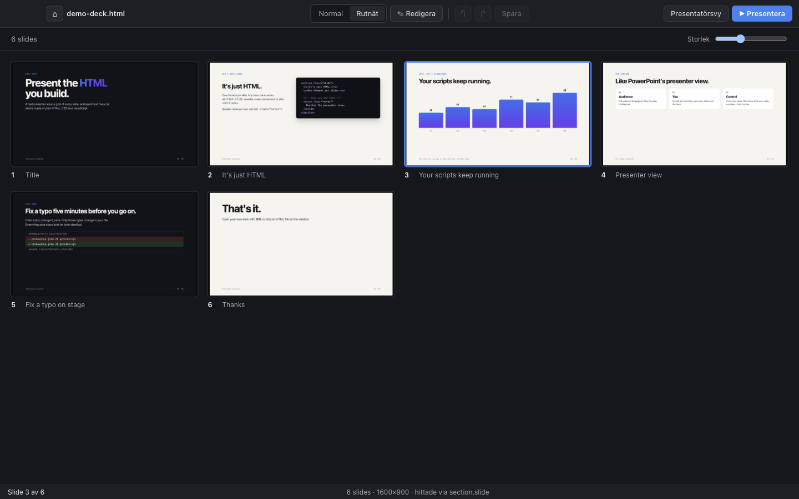
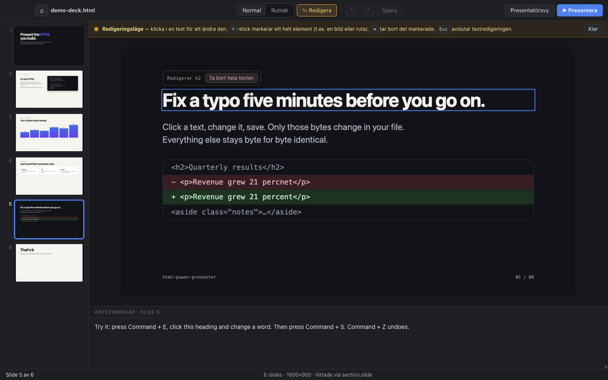
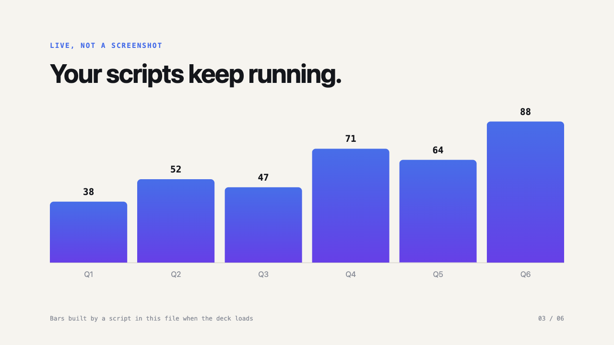

<p align="center"></p>

<h1 align="center">HTML Power Presenter</h1>

<p align="center">Like PowerPoint's presenter view, but for presentations made of HTML, CSS and JavaScript.<br>A macOS desktop app built with Electron.</p>


If you build slide decks as single HTML files (by hand, with reveal.js, or generated by an AI), a browser tab is a poor stage. HTML Power Presenter opens the file and gives you what slide software has:

- **Presenter view on two screens.** The audience sees only the slide, full screen on the projector. You see the current and next slide, your notes, a timer and the clock.
- **Grid of every slide**, with real thumbnails.
- **Edit mode** for last-minute fixes. Click a text, change it, save. Only the bytes you changed are written; the rest of the file stays byte for byte identical.
- **Your deck keeps running.** The deck's own scripts, animations, charts and code demos work as in a browser. The app only decides which slide is shown.

> The app's interface is in Swedish for now (*Redigera* = Edit, *Rutnät* = Grid, *Presentera* = Present).

| Normal view | Grid |
|---|---|
|  |  |
| **Edit mode** | **Audience window** |
|  |  |

## Install

You need macOS and [Node.js](https://nodejs.org) 22.12 or newer.

```bash
git clone https://github.com/peterkurzwelly/html-power-presenter.git
cd html-power-presenter
npm install
npm start                # run from source
```

To build the app and put it in `~/Applications`:

```bash
npm run install-app
```

This builds `HTML Presenter.app` for your Mac's processor, signs it ad hoc so macOS will run it, and registers it for `.html` files. After that you can right-click any `.html` file in Finder and choose **Open With → HTML Presenter**.

If `npm start` says Electron failed to install, download its binary again with `node node_modules/electron/install.js`.

## Try it

Open [`examples/demo-deck.html`](examples/demo-deck.html): ⌘O, drag the file onto the window, or `npm start -- examples/demo-deck.html`.

## Using it

| | Shortcut |
|---|---|
| Open a deck | ⌘O, or drag an `.html` file onto the window |
| Normal view / Grid | ⌘1 / ⌘2 |
| Edit mode | ⌘E |
| Save / Save as | ⌘S / ⇧⌘S |
| Undo / Redo | ⌘Z / ⇧⌘Z |
| Present from the current slide | ⌘↩ |
| Present from the start | ⇧⌘↩ |
| Rehearse (presenter view, no audience window) | ⌥⌘↩ |
| Show or hide notes | ⌥⌘N |

### While presenting

| Key | Does |
|---|---|
| → ↓ Space PageDown N Enter | next slide |
| ← ↑ PageUp Backspace P | previous slide |
| a number, then Enter | jump to that slide |
| B or . | black screen |
| W or , | white screen |
| G | show every slide |
| T | restart the timer |
| Esc | stop presenting |

Presentation clickers send these keys, so they work too. With two screens, the audience window goes full screen on the screen the app window is *not* on. **Byt skärmar** swaps them. With one screen, the audience window covers it. Plug in a projector mid-talk and the audience window moves there.

### Editing

Press ⌘E. Then:

- **Click a text** to edit it in place. Esc or a click elsewhere finishes.
- **⌥-click** selects a whole element (an image, a card, a row). **↑ Yttre element** selects the element around it.
- **⌫** deletes the selected element.
- **⌘Z** undoes, **⌘S** saves.

The first save after opening a file puts a copy of the original in `~/Library/Application Support/HTML Presenter/Säkerhetskopior/`.

If the file changes on disk while it's open (say you regenerate it with an AI tool), the app reloads it. If you have unsaved edits, it asks first.

## What decks work

Any HTML file where each slide is its own element. The app looks for slides in this order and uses the first rule that finds two or more:

`deck-stage > section` · `.reveal .slides > section` · `.slides > section` · `section.slide` · `div.slide` · `.slide` · `[data-slide]` · `body > section` · `main > section` · `.step` · `body > article` · finally the element with the most `<section>` children.

If the deck hides inactive slides until they get a class such as `active`, `on` or `current`, the app works out which class it is and uses it.

**Slide size** comes from `<deck-stage width height>`, from `<meta name="slide-size" content="1600x900">`, or is measured from the first slide. If none of those work, it's 1920×1080.

**Speaker notes** can be any of:

```html
<section class="slide">
  …
  <aside class="notes">Shown only in the presenter view.</aside>
</section>

<section class="slide" data-notes="Also works as an attribute.">…</section>

<script type="application/json" id="speaker-notes">["Notes for slide 1", "Notes for slide 2"]</script>
```

## Security

A deck runs its own JavaScript inside the app, just as it would in a browser. It can read files in **its own folder and subfolders** (so `assets/` work) and nothing else on your disk. It can also reach the network, for web fonts and the like. Open decks you would also open in a browser.

## How it works

- The deck is loaded once per view (main view, presenter's current and next slide, audience window). [`controller.js`](src/renderer/controller.js) is injected first in `<head>`. It finds the slides and catches the keyboard so the deck's own navigation never fires. It then shows one slide at a time, pinned to a box the size of the slide. The app scales that box to fit.
- Thumbnails are rendered in a hidden window that steps through the slides and captures each one.
- **Edits are surgical.** On open, every element in `<body>` gets a `data-hp-id` attribute in an in-memory copy of the source ([`deckstore.mjs`](src/main/deckstore.mjs)). An edit rewrites only the inside of that one element in the copy. Saving removes exactly the attributes that were added. Everything you didn't touch is written back unchanged.

| File | Role |
|---|---|
| `src/main/main.mjs` | Windows, displays, menus, the `hpres://` file server, file watching |
| `src/main/deckstore.mjs` | Source text, element markers, edits, undo, save |
| `src/main/thumbs.mjs` | Thumbnails in a hidden window |
| `src/main/preload.cjs` | The API the app's UI uses to talk to the main process |
| `src/renderer/controller.js` | Runs inside the deck: slides, navigation, media, editing |
| `src/renderer/slideview.js` | One scaled view of a live deck |
| `src/renderer/app.js` | Main window: start screen, normal view, grid, editing, presenter view |
| `src/renderer/audience.*` | The audience window |

## Development

```bash
npm start                               # run from source
npm run dual                            # audience window as a normal window, to test two screens on one
npm test -- examples/demo-deck.html     # end-to-end test on a copy of a deck
node scripts/screenshots.mjs            # regenerate the screenshots in docs/
npx electron scripts/make-icon.cjs      # redraw the app icon
npm run package                         # build into dist/ without installing
```

`npm test` drives the real app with Playwright. It opens a copy of the deck and checks that the deck can only read files in its own folder. It steps through the views, edits a text and saves, then checks that only those bytes changed. It deletes an element, undoes, and presents with an audience window. It never touches the file you pass in. Set `HP_EXEC` to the path of a built app's binary to test the packaged app instead of the source.

## Status

Early version, built for my own talks and tested on macOS (Apple Silicon) with about a dozen real decks. The two-screen presenter view has mostly been tested with `npm run dual`, which fakes the second screen.
